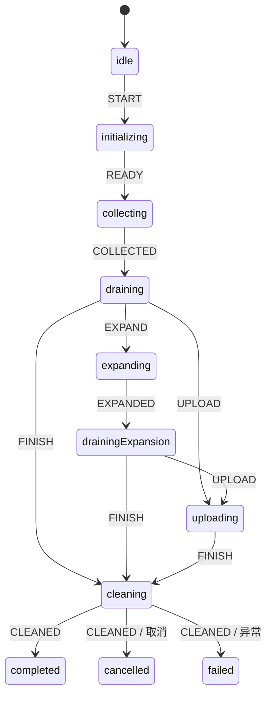

# 采集任务生命周期

采集任务用项目已有的 XState 5 和 RxJS 7 管理，不需要增加运行时依赖。

## 状态与职责

任一运行阶段均可通过 `CANCEL`、`FAIL` 进入 `cleaning`。清理完成后才进入终态；正常结束不再通过 `reason = success` 推断。

前端和服务端仍使用原有 `TaskStatus`：运行阶段统一映射为 `running`，队列等待为 `pending`，最终为 `completed`、`failed`、`cancelled`。IPC 进度额外携带 `phase`，现有界面可以继续使用。

`phase` 为扁平字符串。取消后立即推送 `stopping`，正常结束进入 `cleaning`；界面分别显示“终止中”和“收尾中”。这些阶段不作为服务端状态提交。点击终止后界面立即显示加载状态，并禁用开始、重复终止、编辑和删除；实际取消接口在回收完成后返回最终任务快照。

任务列表同时订阅 `task-status-update`。刷新列表时优先使用本地活跃任务及其阶段；结果落盘、状态同步尚未完成时仍保持结束中的提示，清理完成后才恢复操作入口。

- `Collection`：一次运行的资源所有者。重复 `run()` 返回同一个 Promise；重新执行由管理器创建新实例。
- `collection-machine.ts`：允许的阶段转换和最终结果。
- `TaskScope`：RxJS 订阅、取消等待和操作超时；退订会触发底层 `AbortSignal`。
- `TaskQueueService`：`mergeMap` 控制并发，商品处理并发为 3，保存并发为 1。只保留成功/失败计数，不缓存已完成商品对象。
- `TaskManager`：只在运行结束、结果落盘和清理完成后移除任务并释放并发名额。退出和切换账号共用同一个停止 Promise。

## 结束与异常

生产者请求、商品处理和保存都被等待；拓店按店铺排空队列，上架仅使用已经确认保存成功的商品。达到目标数量后中止其余商品任务。

取消、窗口关闭、渲染进程退出、超时、保存失败均有明确的结束路径。HTTP 请求传递 `AbortSignal`；窗口取消时移除 IPC/事件监听并关闭窗口。不能真正取消的旧 Promise，其迟到结果会被信号检查拦截，不能继续入队保存。

资源清理幂等，某个资源释放失败也继续处理剩余资源。默认单操作超时 30 秒、商品任务 120 秒、自动上架 10 分钟；窗口加载和结果落盘也有独立期限。队列等待依赖各商品的超时和整个作用域的取消。整项任务可通过 `timing.run` 设置总时限，默认保留正常大批量采集持续运行的能力；测试通过依赖注入缩短期限。

状态同步串行执行，并设置独立的 5 秒超时；断网不会阻止本地资源回收，但云端状态可能未成功同步。进程被强制终止时无法执行 JavaScript 清理，内存由操作系统回收，不能将 `finally` 当作服务端状态持久化保证。

## 结果与内存

商品结果保存在 Electron `userData/collection-results/<账号哈希>/`，每个任务分为商品文件和摘要文件。管理器最多在内存中缓存 200 个摘要，手动上架时才读取商品文件；删除任务时同步删除缓存。商品文件不因任务完成而自动删除，以保留手动上架能力。

保存失败的商品不会加入上架结果；额度不足同时处理 402/403。已被服务端接受的请求不因客户端取消而自动回滚。

## 验证

运行 `npm run test:collection`。测试使用注入的服务和 Electron 事件替身，不访问真实店铺，也不会保存或上架真实商品；覆盖状态转换、延迟生产者、拓店排空、取消、超时、迟到结果、窗口监听释放、清理异常、管理器并发名额以及结果缓存。

运行 `npm run build:electron` 编译主进程代码。
