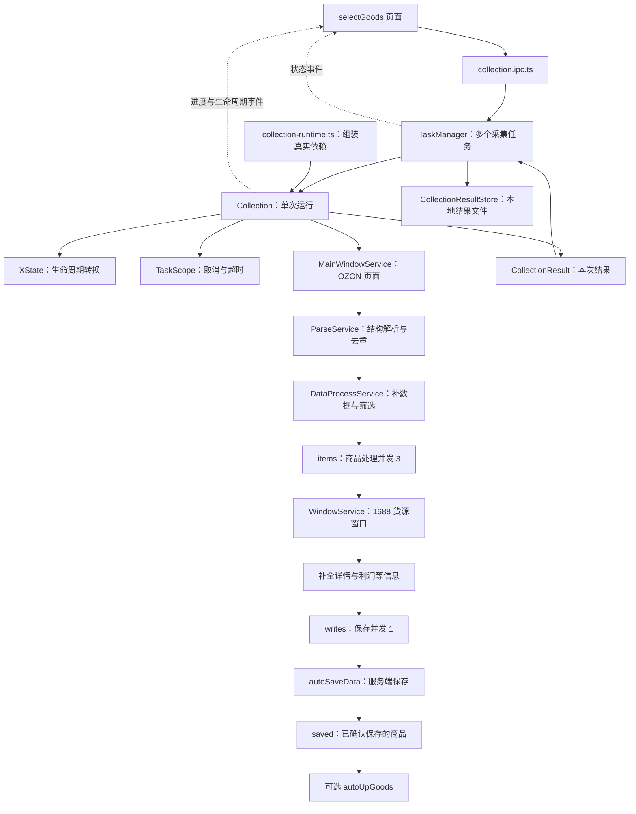
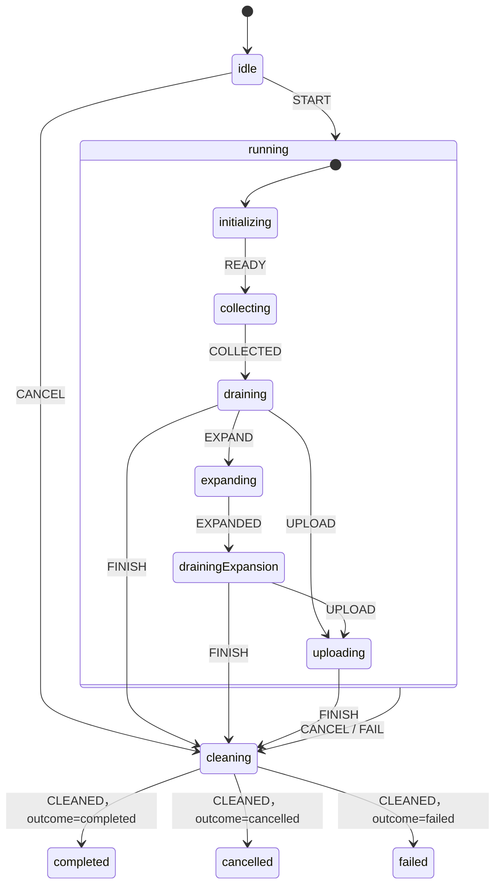

# Collection 采集模块阅读指南

本文对应当前目录的实现，目标是帮助第一次接触这部分代码的人找到入口、串起调用链，并理解状态、并发、取消和资源释放之间的关系。

建议先读第 1～4 节建立整体认识，再根据要修改的功能跳转到具体模块。不要从窗口 DOM 脚本或 Excel 字段映射开始逐行阅读，容易丢失任务的主线。

## 1. 先认识三个层次

这套代码同时管理三种不同粒度的工作：

| 层次 | 负责人 | 管理的内容 | 当前并发方式 |
| --- | --- | --- | --- |
| 多个采集任务 | `TaskManager` | 用户创建的任务、排队、启动、停止、结果缓存 | 默认同时运行 4 个任务，可配置 |
| 一次采集运行 | `Collection` | 从打开 OZON 到采集、拓店、上架、清理的完整流程 | 一个实例只负责一次运行 |
| 一个商品的处理/保存 | `TaskQueueService` | 找 1688 货源、补全详情，以及提交保存 | 商品处理并发 3；保存并发 1 |

所以，管理器的 `taskQueue` 与 `Collection.items` 不是同一个队列：前者存采集任务 ID，后者处理商品。`Collection.writes` 则是另一个商品队列，专门串行保存。



图中是业务数据流；实际依赖通过 `collection-runtime.ts` 注入，商品处理和保存之间通过队列衔接，并非整条链都直接同步调用。

## 2. 推荐从哪里开始读

### 第一轮：先弄懂一次任务如何完成

| 顺序 | 文件与符号 | 这一遍需要回答的问题 |
| --- | --- | --- |
| 1 | [type.ts](./type.ts)：`Task`、`CollectionResult`、`CollectionPhase` | 输入配置、运行阶段和最终结果分别长什么样？ |
| 2 | [collection.services.ts](./collection.services.ts)：`run → execute → workflow` | 一次任务有哪些步骤？成功和异常最终走到哪里？ |
| 3 | [collection-runtime.ts](./collection-runtime.ts)：`collectionDependencies` | `runtime.main/source/parse/data` 实际绑定哪个类？`deps.save/upload` 实际调用谁？ |
| 4 | [collection.services.ts](./collection.services.ts)：`getHtmlData → processData → enqueue → taskHandle → saveGoods` | 一个商品怎样从页面进入队列，并成为已保存结果？ |
| 5 | [task-manager.services.ts](./task-manager.services.ts)：`startTaskById → executeTask` | 谁决定何时启动任务、何时释放并发名额？ |
| 6 | [collection.ipc.ts](../../ipc/collection.ipc.ts) 与 [页面 index.vue](../../../src/views/selectGoods/index.vue) | 用户的点击如何进入主进程？主进程如何更新页面？ |

第一轮只跟这条主线，遇到解析器或窗口服务可以暂时只看方法签名和返回值。

### 第二轮：再读状态、取消和回收

依次阅读：

1. [collection-machine.ts](./collection-machine.ts)：允许哪些事件和转换。
2. `Collection.cancel / fail / cleanup / getPhase`：业务怎样驱动状态机。
3. [task-scope.ts](./task-scope.ts)：取消如何传递，超时如何结束等待。
4. [task-queue.services.ts](./task-queue.services.ts)：并发、排空、销毁分别做什么。
5. `TaskManager.executeTask / cancelTask / stopAllTasks / getTask`：回收期间为什么还占并发名额。
6. [task-state.ts](../../../src/views/selectGoods/task-state.ts)：页面如何解释“终止中”和“收尾中”。

### 第三轮：按具体业务深入

- 页面结构变化、抓不到商品：读 `main-window.services.ts`、`parse.services.ts`。
- 筛选条件或利润结果不对：读 `data-filter.services.ts`、`interface.services.ts`，并区分本地规则和服务端计算。
- 1688 货源结果不返回：读 `1688-window.services.ts`，继续跟到 [1688preload.ts](../../preloads/1688preload.ts)。
- 完成后的结果、手动上架：读 `collection-result-store.ts`、`TaskManager.upGoods`、`autoUpGoods`。
- Excel 导出：读 `excel.services.ts`，同时检查当前调用方是否真的调用了 `saveExcel`。

## 3. 目录中每个模块负责什么

```text
collection/
├── task-manager.services.ts     多任务调度与最终回收
├── collection.services.ts       单次采集流程与资源所有权
├── collection-runtime.ts        真实依赖组装
├── collection-machine.ts        XState 生命周期定义
├── task-scope.ts                可取消的等待与操作超时
├── task-queue.services.ts       RxJS 商品队列
├── main-window.services.ts      OZON 窗口与页面请求
├── 1688-window.services.ts      1688 搜图窗口与 IPC 回包
├── parse.services.ts            页面/API 数据解析与去重
├── data-filter.services.ts      数据补全、筛选、详情处理
├── interface.services.ts        保存、上架、配置等接口封装
├── collection-result-store.ts   本地结果与摘要存储
├── excel.services.ts            Excel 工具封装
└── type.ts                      共享类型
```

### 3.1 `task-manager.services.ts`：多任务的调度者

核心类为 `TaskManager`，通过 `getInstance()` 获取单例。它负责创建/修改/复制任务、分配并发名额、维护等待队列、停止任务、缓存结果摘要，以及手动上架和删除结果。

优先看这些成员：

| 成员 | 含义 |
| --- | --- |
| `tasks` | 尚由管理器持有的 `Collection` 实例，包括未开始、排队和执行中的任务 |
| `activeTasks` | 正在占用并发名额的任务 ID；收尾期间也占用 |
| `executions` | 覆盖运行、结果落盘和管理器清理的 Promise |
| `taskQueue` | 等待启动的采集任务 ID 数组 |
| `filePathList` | 已结束任务的结果摘要缓存，最多 200 条；名字保留了历史含义，实际不只是文件路径 |
| `stopping / stopPromise` | 全部停止期间阻止启动新任务，并让重复调用共用停止过程 |

关键阅读路径：

- 创建：`addTask` 请求服务端创建/编辑，再注册 `Collection`。此时不创建采集窗口。
- 启动：`startTaskById` 判断并发名额；有名额进入 `executeTask`，否则标记 `pending`。
- 执行：`executeTask` 等待 `task.run()`，异常时也尝试从 `CollectionRunError.result` 取出部分结果。
- 收尾：保存结果文件，调用 `clearStatus`，移除活跃记录和实例，再调度下一个任务。
- 重跑：`reExecuteTask` 使用新的运行实例，避免复用已停止的状态机和取消信号。
- 全停：`stopAllTasks` 清空等待队列，取消各任务，等待执行记录结束，再重置服务端状态和本地容器。

`getTask` 还承担运行快照的修正：即使 `Collection` 已产生终态，只要管理器仍在同步状态或保存结果，对外仍暴露 `stopping/cleaning`，防止页面提前允许重新执行。

### 3.2 `collection.services.ts`：单次运行的组织者

核心类为 `Collection`。它决定先做什么、何时等待队列、何时拓店、何时上架，并拥有本次运行创建的服务和队列。

建议按下面的分组阅读，不必从文件第一行一路读到底：

| 关注点 | 方法 |
| --- | --- |
| 生命周期入口 | `run`、`execute`、`workflow` |
| 商品生产 | `categoryMode`、`getHtmlData`、`processData`、`enqueue` |
| 商品消费 | `taskHandle`、`saveGoods`、`waitForAllTasks` |
| 额外采集 | `expendShop` |
| 异常与清理 | `fail`、`closeHandle`、`cancel`、`cleanup`、`clearStatus` |
| 状态和界面事件 | `getPhase`、`getTaskInfo`、`setStatus`、`outputLog`、`emitLifecycleState` |
| 配置转换 | `initQueryParams`、`getUpDate` |

`run()` 重复调用返回同一个执行 Promise。这个 Promise 在本实例的清理和状态同步结束后才完成；管理器的结果落盘是更外层的另一段工作。

`execute()` 创建服务和两个队列，运行 `workflow`，并在 `finally` 中统一构造结果、清理资源、进入终态。失败或取消时抛出带结果的 `CollectionRunError`，使管理器仍有机会保存已经成功采集的商品。

### 3.3 `collection-runtime.ts`：真实实现的组装点

这里定义生产环境的 `collectionDependencies`：

- `main` → `MainWindowService`。
- `parse` → `ParseService(main)`。
- `source` → `WindowService(parse)`。
- `data` → `DataProcessService`。
- `excel` → `ExcelService`。
- `request/save/upload` → 共享 HTTP 客户端、`autoSaveData`、`autoUpGoods`。
- `log/metrics` → 日志与业务指标。

这是理解依赖注入的关键：`Collection` 中看到的 `deps` 是能力契约，具体实现要到这里确认。测试可以注入替身和较短的时间参数，无需打开真实 Electron 窗口。

### 3.4 `collection-machine.ts`：生命周期规则

它使用 XState 描述允许的状态转换和结束结果，不执行抓页面、保存、关闭窗口等业务操作。业务操作仍由 `Collection` 执行，再发送事件。

重点看 `running` 的子状态、父级的 `CANCEL/FAIL`，以及 `cleaning` 收到 `CLEANED` 后如何根据 `context.outcome` 选择终态。完整说明见第 5 节。

### 3.5 `task-scope.ts`：取消和超时基础设施

`TaskScope` 组合 RxJS 与 `AbortController`：

- `run(operation, ms, label)`：执行一个操作，提供子信号，并为等待设置超时；`ms = 0` 表示不设该层时限。
- `sleep(ms)`：可被取消的延迟。
- `check()`：如果作用域已停止，立即抛出停止原因。
- `stop(reason)`：幂等中止，通知等待者并解除父信号监听。
- `abortableDelay`：供窗口等代码使用的可取消定时器，结束时移除监听。

`TaskCancelledError` 表示取消，`TaskTimeoutError` 表示操作超时。

RxJS 退订可以结束本地等待，但任意 Promise 不会因此自动停止底层工作。HTTP、窗口操作还要接收并使用 `AbortSignal`，在 `await` 后检查信号，防止迟到结果继续入队或保存。

### 3.6 `task-queue.services.ts`：商品处理队列

`TaskQueueService` 通过 `Subject → mergeMap` 控制并发，用 `pending/active` 两个 ID 集合和 `BehaviorSubject` 记录当前规模。

- `addTask(goods[])`：自动开始处理，不需要再调用启动方法。
- `whenIdle()`：等待当前待处理和活跃项都为零；调用方必须先确保生产者已结束，否则后续仍可能入队。
- `getTaskCount()`：只统计等待项；活跃项要看 `getActiveCount()`。
- `destroy()`：停止作用域、退订、丢弃缓冲任务、清空 ID 集合。
- `startProcessing()`：保留的兼容方法，当前实际返回 `whenIdle()`。

队列只在等待和处理中去重，不永久保存所有完成商品；完成后保留成功/失败计数。最终商品结果属于 `Collection.saved`。

### 3.7 `main-window.services.ts`：OZON 页面适配层

这里的 `MainWindowService` 管的是采集使用的 OZON 窗口。项目 `inspection` 目录也有同名文件，阅读时要确认路径。

主要方法：

- `createCollectionWindow`：创建窗口并等待页面就绪。
- `getHTML / getDomain / scrollPage`：读取页面和滚动。
- `getSellingData / getDataByApi`：通过页面环境请求卖家或商品数据。
- `changeUrl`：复用窗口进入拓展店铺。
- `destroy`：关闭本服务持有的窗口。

窗口加载会处理就绪、失败、超时、取消，并在结束时移除监听。异常关闭或渲染进程退出通过回调通知 `Collection`；主动销毁则避免把正常关闭误报成采集失败。

页面请求通过 `fetchPage` 在渲染端登记 `AbortController`，主进程取消时通知渲染端中止对应请求，结束后移除登记。因此排查页面请求卡住时，要同时看主进程信号和渲染端请求注册表。

### 3.8 `1688-window.services.ts`：按商品查找货源

核心类名为 `WindowService`。`createWindow(sourceType, cover, signal)` 根据商品图片打开隐藏窗口，触发图片搜索，等待结果并解析货源价格、链接和图片。

每个窗口有独立 ID 和 `result-page-${id}` IPC 通道，并校验回包的 `sender`。根据 `sourceType` 执行相应排序，再通过 `ParseService['1688Parse']` 提取结果。页面侧配合逻辑在 [1688preload.ts](../../preloads/1688preload.ts)。

重点读 `open` 内的完成与清理路径：成功、异常、取消、窗口关闭或进程退出，都需要结束调用方等待，并移除 IPC、事件监听和窗口记录。`destroy()` 则停止该服务仍持有的全部窗口。

### 3.9 `parse.services.ts`：解析结构和记录去重信息

`ParseService` 负责把页面 HTML/API 结构变成后续流程使用的商品对象：

| 方法/成员 | 作用 |
| --- | --- |
| `ozonListParser` | 解析列表页商品，并补充卖家信息 |
| `ozonDetailListParser` | 对分类接口返回的商品列表去重 |
| `ozonDetailParse` | 解析详情接口结构并合并商品信息 |
| `1688Parse` | 从 1688 页面提取货源信息 |
| `aoXiaParse` | 文件中的另一种页面解析实现，是否生效要继续查调用方 |
| `getDataCount` | 返回解析器去重集合的规模，不是保存成功数量 |
| `guessLikeList` | 留给拓店流程继续查询的候选链接 |
| `destroy` | 清空集合并解除窗口服务引用 |

注意：该解析器并非纯函数集合。`ozonListParser/ozonDetailParse` 会通过注入的窗口服务请求卖家数据，因此它们也有异步等待和取消边界。

### 3.10 `data-filter.services.ts`：数据补全与筛选

核心类为 `DataProcessService`，主要入口：

- `getBaseData`：批量请求基础经营数据，合并到商品，并建立本次运行的数据缓存。
- `aiFilterData`：按代码内的固定规则筛选；当前方法本身不调用大模型。
- `filterData(data, task, type)`：根据任务配置筛选，`type` 可为 `base/detail/merge`，对应不同阶段可用的字段。
- `getDetailData`：根据 `upMode` 调用不同的服务端详情/筛选接口，合并缓存数据并处理中文名称。
- `getChineseName`：请求翻译；普通失败可以回退原名称，取消需要继续向上抛出。
- `destroy`：清空本次运行的数据缓存。

修改筛选规则前，先确定字段在哪个阶段产生。分类接口的数据和页面解析的数据不完全相同，不能仅凭字段名相同就假定单位、空值和含义一致。

### 3.11 `interface.services.ts`：服务端接口与上架参数封装

这个文件集中处理配置、店铺、物流、保存和上架等接口，主要追踪：

- `autoSaveData → saveData`：分批保存商品，累计服务端返回的 `newCount`。工具支持每批 1000 条，当前 `Collection.saveGoods` 每次传入一个商品。
- `autoUpGoods → batchUpGoods`：读取配置/店铺/汇率，构造价格、库存、货号等参数，压缩后分批提交；当前上架批次大小为 100。
- 配置列表、店铺列表、汇率缓存：用于减少重复获取。

这些是业务服务端接口；`MainWindowService` 通过 OZON 页面发出的请求是另一类来源。排查时应先确认失败属于哪一侧。

`autoUpGoods` 以字符串返回结果，`'success'` 才表示该封装认为成功；自动上架返回其他内容会使本次采集运行失败。这里只能看到客户端处理，服务端事务、幂等和回滚能力需要另外核实。

### 3.12 `collection-result-store.ts`：完成结果的本地存储

`CollectionResultStore` 把完整商品与摘要拆开：

- `save`：分别写入商品文件和摘要文件，返回不含 `upGoodsList` 的摘要。
- `summary`：读取轻量摘要，文件不存在时返回 `undefined`。
- `goods`：按需读取完整商品，供手动上架使用。
- `remove`：删除该任务的两类文件。

管理器按账号哈希选择目录，存储层再按任务 ID 哈希生成文件名：

```text
Electron userData/
└── collection-results/
    └── <账号 ID 的 SHA-256>/
        ├── <任务 ID 的 SHA-256>.goods.json
        └── <任务 ID 的 SHA-256>.meta.json
```

每个文件采用临时文件写入后重命名，避免直接覆盖时暴露半份内容；两个文件依次写入，不构成跨文件事务。哈希用于目录/文件命名，并不表示内容已加密。

### 3.13 `excel.services.ts`：Excel 工具能力

封装 `ExcelWriter`，提供表头初始化、`saveExcel`、落盘、文件路径查询、旧文件清理和销毁。

当前 `Collection` 主流程只通过其契约使用 `DeleteFilled/getFilePath/destroy`，没有把每个采集商品交给 `saveExcel`。因此不能把“服务端商品保存成功”直接理解为“已生成 Excel”；修改导出功能时需要追查真实调用方，不能只看类里存在写入方法。

### 3.14 `type.ts`：公共数据契约

优先掌握：

- `Task`：服务端任务配置及运行快照；`phase` 是可选本地字段。
- `TaskStatus`：原有六种业务状态。
- `CollectionPhase`：更细的本地生命周期阶段。
- `CollectionResult`：结束结果，包括完整商品、进度、状态和可选错误。
- `CollectionResultSummary`：去掉 `upGoodsList` 的结果摘要。
- `Query`：分类选品接口的查询参数。
- `Config / ShopData / Response`：配置、店铺和接口返回结构。

前端还有独立的 [selectGoods.d.ts](../../../src/types/selectGoods.d.ts)。更改跨进程字段时，需要同步检查两侧类型和 IPC 返回结构。

## 4. 沿真实调用链理解一次采集

### 4.1 从点击开始到进入工作流

1. 页面调用 `collection-create-and-start`，或对已有任务调用开始/重新执行相关 IPC。
2. IPC 委托 `TaskManager` 创建或获取任务，并选择启动入口。
3. `startTaskById` 分配名额或加入等待队列。
4. `executeTask` 登记活跃任务和执行 Promise，等待 `Collection.run()`。
5. `run` 发送 `START`，标记业务状态 `running`，进入 `execute`。
6. `execute` 延迟创建服务，创建 `items/writes` 队列，调用 `workflow`。

`workflow` 的顺序为：初始化旧表格文件 → 创建 OZON 窗口 → 首轮采集 → 排空队列 → 可选拓店并排空 → 可选自动上架。

### 4.2 页面采集分支：一件商品如何保存

当 `isUseCategorySelect !== 0` 时走 `getHtmlData`：

```text
getHtmlData
  └─ main.getHTML
      └─ parse.ozonListParser：解析、去重、补卖家信息
          └─ processData
              ├─ data.getBaseData：补基础数据
              ├─ aiFilterData 或 filterData：筛选
              └─ enqueue → items.addTask
                  └─ taskHandle（队列回调，最多同时 3 个）
                      ├─ source.createWindow：1688 搜图
                      ├─ data.getDetailData：补货源后的详情与筛选
                      └─ writes.addTask
                          └─ saveGoods（队列回调，串行）
                              ├─ deps.save → autoSaveData
                              └─ 确认 count > 0 后更新 saved/targetData
```

这里的 `items.addTask` 只是投递任务，`taskHandle` 由队列消费时调用；它完成后也只是把结果交给保存队列，不表示已经保存成功。

页面循环会滚动、等待和重新解析。达到目标、连续 10 次无新增，或连续 3 次未滚动时结束循环；触底后仍会解析，以接住延迟加载的最后一批商品。

### 4.3 分类选品分支

只有 `isUseCategorySelect === 0` 时进入 `categoryMode`，不要根据变量名反推枚举含义。

这条路线通过分类接口分页获取列表，更新查询游标，经过 `ozonDetailListParser → filterData(base)`，再串行请求/解析商品详情，经过 `filterData(detail)` 后进入同一条 `items → writes` 流水线。

分页生产者本身也必须被等待；只等待商品队列为空，不能证明分类接口已经停止生产商品。

### 4.4 首轮结束后的拓店与上架

`waitForAllTasks` 先等待 `items`，再等待 `writes`，因为商品处理期间仍可能产生新的保存任务。

开启 `expendType` 且目标尚未达到时，`expendShop` 从已保存商品的卖家与 `guessLikeList` 中选取店铺，过滤评分、排序并去重，复用 OZON 窗口进入店铺继续采集。每次访问后等待队列排空，避免拓店生产者提前结束。

开启自动上架且 `saved` 非空时，才调用 `deps.upload`。上架数据来自已确认保存的商品，而不是所有已解析或已匹配货源的商品。

手动上架走另一条路径：页面 IPC → `TaskManager.upGoods` → 从本地结果文件读取商品 → `autoUpGoods`，不需要重跑采集工作流。

## 5. 状态要分清三种含义

| 概念 | 来源 | 示例 | 用途 |
| --- | --- | --- | --- |
| 业务状态 `taskStatus` | `TaskStatus` | `pending/running/completed` | 服务端任务列表及粗粒度业务状态 |
| 运行阶段 `phase` | 状态机快照经 `getPhase/getTask` 转换 | `collecting/draining/stopping` | 本地执行细节和页面操作控制 |
| 结束意图 `context.outcome` | 状态机上下文 | `completed/cancelled/failed` | 清理结束后选择哪个终态 |

`outcome` 初始值为 `completed`，只是正常结束的默认选择，不表示任务已经执行完。必须结合状态机当前节点判断。



`stopping` 是对外暴露的阶段别名，状态机里没有单独的 `stopping` 节点：`cleaning + outcome=cancelled` 被映射为 `stopping`。

还有一层管理器保护：当状态机已经结束，但 `executions` 尚未释放，`TaskManager.getTask` 仍可能输出 `stopping/cleaning`。所以判断能否重新操作，应使用完整任务快照和页面 helper，不能只看 `taskStatus` 是否为终态。

`setStatus` 串行同步服务端状态，并为每次同步设置独立期限。`phase` 不作为新增业务状态提交给服务端。

## 6. 为什么取消不会立即变成“已取消”

一次正在运行任务的取消路径是：

1. 页面 `cancelTask` 立即把 ID 加入 `cancellingTaskIds`，显示“终止中”并锁定相关操作。
2. IPC 调用 `TaskManager.cancelTask`，先移除等待队列中的任务 ID。
3. `Collection.cancel` 发送 `CANCEL`，立即推送 `stopping`，再停止根 `TaskScope`。
4. 信号中止队列、网络请求、延迟和窗口等待；正在等待的工作流退出。
5. `execute.finally` 在清空商品缓存前构造结果，然后执行统一 `cleanup`。
6. 清理后发送 `CLEANED`，更新最终业务状态，等待有期限的状态同步。
7. 管理器保存本地结果，完成兜底清理，移除活跃记录并释放名额。
8. `cancelTask` 返回最终任务快照，页面合并快照并移除本地取消标记。

因此，“接受取消请求”和“所有收尾结束”是两个时刻。前者用于立即反馈 UI，后者才允许重跑。任务如果已经进入正常或失败收尾，后到的取消请求会等待已有结束过程，不强行改写原有结果。

### 6.1 资源归谁释放

| 资源 | 直接所有者 | 释放入口 |
| --- | --- | --- |
| 单次任务的服务引用、`saved` | `Collection` | 幂等 `cleanup` |
| 商品处理和保存队列 | `Collection` 创建，队列管理内部订阅 | `items/writes.destroy` |
| 根取消信号与延迟 | `TaskScope` | `stop`、RxJS 退订 |
| OZON 窗口、加载监听 | `MainWindowService` | 操作结束的清理与 `destroy` |
| 1688 窗口、回包 IPC、窗口监听 | `WindowService` | 每次调用的清理与 `destroy` |
| 解析去重集合、基础数据缓存 | `ParseService / DataProcessService` | 各自 `destroy` |
| 活跃任务记录、并发名额 | `TaskManager` | `executeTask.finally` |
| 历史商品结果文件 | `CollectionResultStore` | 删除任务时 `remove`；正常完成后保留供手动上架 |

`cleanup` 按资源逐个捕获释放异常，一个资源失败仍继续释放后面的资源。回收主要依靠解除引用、移除监听、停止订阅和关闭窗口，不应靠强制 GC 来掩盖所有权问题。

进程被强制结束时不能保证执行 JavaScript 的 `finally`；这条清理链也不能保证服务端一定接收到最终状态。

## 7. 页面怎样获得“终止中”的感知

阅读时需要跨出本目录，联看以下文件：

- [collection.ipc.ts](../../ipc/collection.ipc.ts)：请求/响应入口。
- [index.vue](../../../src/views/selectGoods/index.vue)：点击后的即时反馈、事件订阅和列表更新。
- [task-state.ts](../../../src/views/selectGoods/task-state.ts)：状态展示与可操作性判断。

| 通道 | 方向 | 关键内容 |
| --- | --- | --- |
| `collection-cancel-task` | 页面请求主进程 | 收尾结束后返回最终 `Task`，放在响应的 `data` 中 |
| `collection-cancel-all-task` | 页面请求主进程 | 进入管理器的全部停止流程 |
| `collection-get-all-tasks` | 页面请求主进程 | 分页列表合并服务端数据、本地运行快照和结果摘要 |
| `task-progress` | 主进程推送页面 | `{ collectionTask, log }`，任务快照带 `phase` 和进度 |
| `task-status-update` | 主进程推送页面 | `{ task, status }`，用于状态和阶段更新 |
| `task-completed` | 主进程推送页面 | 管理器完成收尾后的完成提示 |

页面显示优先级为：本地已请求取消或 `phase=stopping` → “终止中”；`phase=cleaning` → “收尾中”；否则显示原有 `taskStatus` 文案。

`isTaskClosing` 判断是否正在结束，`isTaskBusy` 还包含运行和排队。开始、编辑、删除、上架等入口统一使用这些判断。页面同时订阅进度和状态事件，卸载时解除订阅。

本地取消标记用于点击后的即时反馈；主进程 `phase` 用于跨事件、刷新列表和其他入口发起的停止。只做其中一边，会丢失另一类场景的感知。

## 8. 数据放在哪里，进度数字是什么意思

### 8.1 三种持久化用途不同

| 位置 | 内容 | 何时使用 |
| --- | --- | --- |
| 服务端选品记录 | `autoSaveData` 已确认保存的商品 | 选品业务记录和额度统计 |
| 本地 JSON 结果 | 完整商品、摘要和终态 | 任务结束后恢复展示、手动上架 |
| Excel 文件 | Excel 工具生成的导出内容 | 取决于实际导出调用，当前采集主线未逐商品写入 |

服务端已保存不保证本地文件一定写入成功；本地落盘失败会记录日志，但管理器仍继续回收。此时手动上架可能缺少所需本地数据。

### 8.2 主要计数与缓存

| 字段/容器 | 实际含义 |
| --- | --- |
| `discovered` / 进度 `total` | 解析器记录的去重商品数量，并非过滤后数量 |
| 进度 `current` | 商品队列和保存队列的待处理项、活跃项之和，并非已经处理的数量 |
| `targetData` / 进度 `totalCount` | 累计服务端确认的新增数量，来自保存返回的 `count` |
| `saved` | 服务端确认新增后保留的商品，按商品 ID 存储，供结果与上架使用 |
| 队列 `completed/failed` | 该队列处理完成/失败次数，不等于选品新增数量 |
| `ParseService` 去重集合 | 当前解析实例见过的商品，生命周期属于本次运行 |
| `DataProcessService.data` | 当前运行补全后的基础数据缓存 |
| 管理器 `filePathList` | 最多 200 条结果摘要，不持有历史任务完整商品数组 |

`totalCount` 和 `saved.size` 的计量来源不同，不宜直接当作永远相等。最终结果里的 `current` 为 0，表示本次执行结束后的结果快照。

达到目标后会销毁剩余商品处理队列；保存队列仍按顺序检查目标，避免继续新增。当前背压在两个队列的“等待项之和”大于 20 时暂停生产，不是对所有内存或活跃任务数的硬限制。

## 9. 超时与失败策略

以下是当前代码默认值，修改时应回到调用点确认覆盖关系：

| 边界 | 默认期限/策略 | 位置 |
| --- | --- | --- |
| 普通 `step`、保存队列单项 | 30 秒 | `Collection` 的 `timing.operation` |
| 商品处理单项 | 120 秒 | `timing.item` |
| 整项任务、排空等待 | 默认不设总时限，仍支持取消 | `timing.run ?? 0` |
| 创建 OZON 窗口 | 100 秒 | `workflow` 与窗口加载逻辑 |
| 进入其他页面 | 窗口加载内层 60 秒，还受外层 `step` 限制 | `changeUrl` 调用链 |
| 1688 单次窗口操作 | 120 秒，还受商品队列期限限制 | `WindowService.createWindow` |
| 自动上架 | 10 分钟 | `workflow` |
| 每次业务状态同步 | 5 秒 | `setStatus` |
| 管理器保存本地结果 | 30 秒 | `executeTask` |

底层共享 [HTTP 客户端](../../utils/request.ts) 还有自己的请求超时。外层等待期限、底层请求期限与取消信号共同生效，不能只根据某一层的数值判断实际等待时间。

失败也分层处理：

- 普通商品处理失败：商品队列记录警告并跳过，其他商品可以继续，整项任务不一定失败。
- 保存失败：保存队列调用 `Collection.fail`，停止整项任务；402/403 同时标记额度不足。
- 主采集窗口异常关闭：通过回调使任务失败。
- 工作流、自动上架失败：进入失败收尾。
- 状态同步失败：记录警告，不阻止本地资源回收，但服务端状态可能滞后。
- 本地结果落盘失败：记录错误，管理器仍释放名额。

取消请求不能自动回滚服务端已经接受的保存或上架操作。信号检查主要阻止后续本地工作和迟到结果继续流转。

## 10. 按现象定位代码

| 现象 | 建议先看 |
| --- | --- |
| 点击终止后页面没有立即变化 | 页面 `cancellingTaskIds`、`task-state.ts`、状态事件订阅 |
| 刷新列表后“终止中”消失或重新允许操作 | `TaskManager.getTask/getAllTasks` 的活跃快照覆盖与 `phase` |
| 任务已显示终态，却一直不启动下一项 | `executeTask.finally` 的结果落盘、`clearStatus` 和并发记录移除 |
| 页面有商品，任务却没有选品结果 | 依次检查解析数、筛选后数、货源结果、详情结果、保存 `count` |
| 分类选品提前完成或漏数据 | `categoryMode` 的分页/游标与被等待的详情请求 |
| 1688 窗口一直挂着 | `createWindow/open`、预加载回包、IPC sender 校验、超时和清理 |
| “获取页面数据报错~~” | `MainWindowService.getDataByApi/fetchPage`，再看页面请求是否成功和是否已取消 |
| 保存成功但进度不增加 | `saveGoods` 的 `code/count`，确认是否为服务端认定的新增商品 |
| 完成后手动上架找不到数据 | `CollectionResultStore` 的账号目录、商品/摘要文件和落盘错误 |
| 任务完成但没有 Excel | 核实 `saveExcel` 是否存在真实调用，区分 JSON 与 Excel |
| 长时间运行后内存持续增加 | 检查窗口/IPC/监听/订阅所有权，再看缓存增长和队列背压；结合实际指标定位 |

## 11. 修改代码时保留的约定

1. **一个实例只运行一次。** 重跑创建新的 `Collection`，不要复用已经 abort 的作用域。
2. **生产者、消费者都要被等待。** 新增异步分支要接入被拥有的 Promise，不能只启动后放任运行。
3. **有底层工作的异步操作要传递信号。** 同时在关键 `await` 后检查取消，防止迟到结果继续保存。
4. **释放名额由管理器统一完成。** 不要因某次状态更新变成终态，就直接删除 `activeTasks`。
5. **新资源要明确所有者和清理入口。** 窗口、定时器、事件、IPC、订阅和缓存都应纳入已有清理链。
6. **新增阶段先改状态机和类型。** 再检查 `getPhase`、管理器快照、前端类型和 helper，避免各处新增互相矛盾的布尔状态。
7. **保存确认后才进入最终商品集合。** 找到货源或计算完详情，不代表服务端已新增记录。
8. **清理保持幂等和逐资源容错。** 某个 `destroy` 抛错不能阻断剩余资源回收。
9. **IPC 字段变动同步检查页面。** 特别是取消接口返回的最终任务快照和两个推送事件。
10. **不要把单文件原子写入理解为完整事务。** 增加恢复、重试等能力前，先明确两份结果文件与服务端数据的一致性边界。

## 12. 用测试反过来理解约束

测试位于 [tests/collection](../../../tests/collection)。不确定某个等待或判断为什么存在时，可以查对应场景：

| 文件 | 适合阅读的内容 |
| --- | --- |
| [lifecycle.test.ts](../../../tests/collection/lifecycle.test.ts) | 生命周期、延迟生产者、拓店、达到目标、保存失败、取消、超时和清理异常 |
| [manager.test.ts](../../../tests/collection/manager.test.ts) | 并发名额、落盘失败、全停、重跑，以及收尾期间的快照 |
| [windows.test.ts](../../../tests/collection/windows.test.ts) | 窗口取消、加载失败、IPC/监听释放和已销毁对象 |
| [result-store.test.ts](../../../tests/collection/result-store.test.ts) | 商品与摘要分离、文件命名、重新读取和删除 |
| [task-view.test.ts](../../../tests/collection/task-view.test.ts) | 点击后的即时终止状态、刷新、操作锁定和最终解锁 |

在仓库根目录执行：

```bash
npm run test:collection
npm run build:electron
```

测试使用注入服务和 Electron 事件替身，不会保存或上架真实商品。它们验证本地生命周期契约，不能代替真实网站 DOM、登录态、验证码和服务端响应的联调。测试环境还应满足测试代码所使用的 Node API，具体脚本见 [package.json](../../../package.json)。

与本文配套的简要设计说明见 [采集任务生命周期](../../../docs/collection-lifecycle.md)。后续变更流程时，建议同时检查本文的调用链、状态说明和模块职责是否仍与实现一致。
