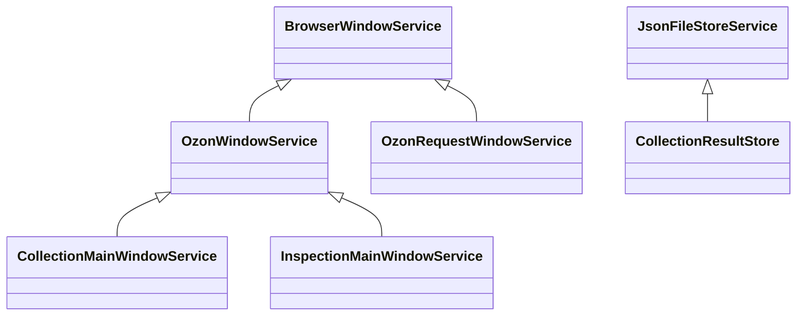

# 公共服务

这里存放与采集、巡查业务无关的基础能力。实现文件统一使用 `xxxx.services.ts`；业务状态机、接口、页面选择器和商品字段留在对应业务目录。`type.ts` 仅承载业务类型，不属于服务实现。

## 模块职责

| 文件 | 职责 | 使用方式 |
| --- | --- | --- |
| [task-scope.services.ts](./task-scope.services.ts) | 可取消的 Promise 等待、定时器、操作超时、父子取消信号 | 组合使用 `TaskScope`，向底层操作传递 signal |
| [task-queue.services.ts](./task-queue.services.ts) | RxJS 并发调度、待处理/活跃 ID 去重、排空和销毁 | 泛型指定任务数据，构造时注入处理函数、并发数和错误策略 |
| [browser-window.services.ts](./browser-window.services.ts) | 单窗口创建、所有权、加载等待、异常关闭、HTML 读取、滚动、页面会话 JSON 请求和销毁 | 业务窗口继承 `BrowserWindowService` |
| [slider-verification.services.ts](./slider-verification.services.ts) | OpenCV 初始化、验证页面准备、滑块检测与拖动，统一最多 3 次尝试 | 组合调用 `SliderVerificationService`；是否恢复由请求方确认 |
| [verification-coordinator.services.ts](./verification-coordinator.services.ts) | 同 Session/来源的请求与验证协调，取消与验证接手 | 请求方通过 `request/recover` 进入协调流程 |
| [json-file-store.services.ts](./json-file-store.services.ts) | 哈希文件名、JSON 读写、单文件原子替换和删除 | 业务存储继承 `JsonFileStoreService` |
| [cron.services.ts](./cron.services.ts) | 按名称注册、启动、停止和删除定时任务 | 使用现有 `CronServices` 单例；当前默认时区为 Asia/Shanghai |
| [memory-monitor.services.ts](./memory-monitor.services.ts) | 内存采样、历史记录、阈值与业务指标日志 | 使用现有 `memoryMonitor` 单例 |
| [sharp.services.ts](./sharp.services.ts) | 图像读取、像素处理及拼图图像匹配工具 | 使用 `SharpServices.getInstance()`；不操作业务页面或验证码 DOM |

公共服务不导入 `collection` 或 `inspection`。同一个模块的消费者统一引用这里，避免同时保留新旧实现，产生多个单例或两套生命周期。

## 窗口：公共生命周期，业务扩展页面行为



图中的两个业务窗口类在各自文件中仍叫 `MainWindowService`，这里使用不同名称便于区分。

基类的 `browserWindow`、`createBrowserWindow`、`loadWindow`、`scrollWindow`、`fetchPage` 对子类开放为 `protected`，公开 `getHTML/getDomain/destroy`。业务类自己的检查标记、DOM 脚本、地址和解析方法仍可保持 `private`。采集读取 HTML 前先做业务检查，再调用 `super.getHTML`；采集和巡查为公共滚动动画传入不同的步长、时长。

```ts
import { BrowserWindowService } from '../common/browser-window.services.js'

export class BusinessWindowService extends BrowserWindowService {
  private checked = false

  async open(url: string, signal?: AbortSignal) {
    signal?.throwIfAborted()
    const win = this.createBrowserWindow({ show: false })
    try {
      await this.loadWindow(win, url, {
        event: 'dom-ready',
        timeoutMs: 60_000,
        signal,
      })
      // 在这里执行本业务的页面检查；必要时在 await 后再次检查 signal。
      this.checked = true
      return win
    } catch (error) {
      this.destroy()
      throw error
    }
  }
}
```

构造时可以传入异常关闭回调。主动 `destroy` 会先解除所有权和生命周期监听，再销毁窗口，不会误触发业务的异常关闭回调。加载等待独立处理成功、主框架加载失败、关闭、渲染进程退出、取消和超时，并移除自己注册的监听。

基类拥有**一个窗口**。1688 搜图服务同时管理多个窗口，还包含独立 IPC 通道、回包 sender 校验及结果解析，因此继续保留自己的多窗口管理；它复用公共 `TaskScope`，没有强行继承单窗口基类。

窗口默认启用隔离、沙箱并关闭 Node 集成；业务传入的 `webPreferences` 会合并覆盖默认值。巡查保留原有的 `webSecurity: false`，采集使用默认配置。

## 队列：通过注入或继承保留业务策略

```ts
import { TaskQueueService } from '../common/task-queue.services.js'

interface Job { id: string; url: string }

export class DownloadQueueService extends TaskQueueService<Job> {
  constructor(download: (url: string, signal: AbortSignal) => Promise<void>) {
    super((job, signal) => download(job.url, signal), 2, {
      timeoutMs: 30_000,
      label: '下载文件',
      onError: error => console.error(error),
    })
  }
}
```

无需扩展时可以直接实例化，不必为了使用队列再写一个空子类。`addTask` 自动开始消费；`whenIdle` 等待当前队列排空；`destroy` 中止活跃工作并丢弃缓冲项。调用方需要等待生产者结束，再等待队列排空。

并发数必须是正整数。任务 ID 在等待和处理期间去重，完成项只保留计数。普通失败如何影响业务由 `onError` 决定：采集商品处理记录警告并继续，商品保存失败则停止整项采集。公共队列不持有商品结果，也不判断会员额度、目标数量或上架条件。

## 存储：公共文件机制，业务定义结果结构

`JsonFileStoreService` 对子类提供 `readJson/writeJson/removeJson`，由业务确定键、数据类型和文件种类。当前 `CollectionResultStore` 定义 `goods/meta` 两类内容，保留 `save/summary/goods/remove` 业务接口。

每份文件分别原子替换，多个文件不构成事务；哈希文件名不表示加密。账号分目录和摘要缓存上限属于任务管理策略，继续由 `TaskManager` 决定。

## 扩展约定与验证

- 公共类只包含跨业务机制；网站行为、业务阶段和错误策略留在业务类。
- 基类内部的监听与资源记录保持私有，子类通过受保护的方法使用能力。
- 新增异步操作应接收 `AbortSignal` 并在迟到结果返回后检查，不能把退订 Promise 等同于已中止底层请求。
- 使用继承前确认所有权一致，尤其不要把多个并行窗口挂到单窗口基类上。
- 修改后执行 `npm run build:electron` 和 `npm run test:collection`。当前测试包括公共窗口加载超时、崩溃、监听清理及业务子类页面检查，以及队列、取消和结果存储回归。

采集业务的完整阅读顺序见 [collection/README.md](../collection/README.md)。

OZON 的两个受限接口已迁到独立请求窗口，其重建、验证和恢复流程见 [ozon/README.md](../ozon/README.md)。
